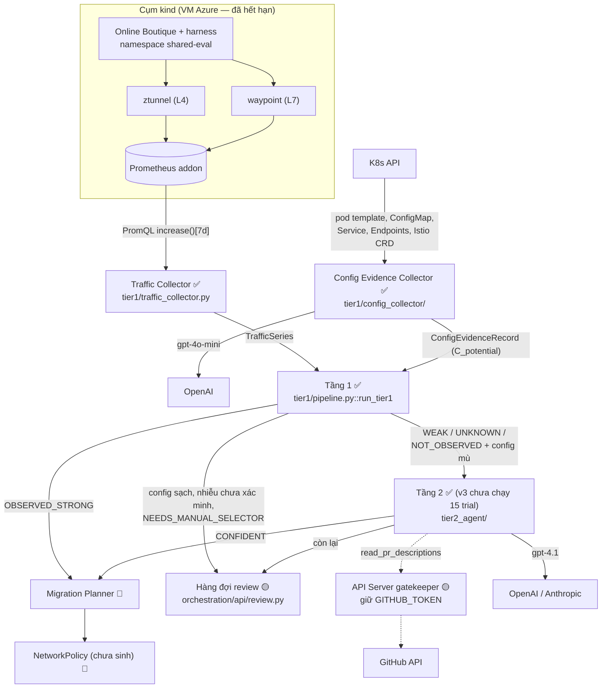
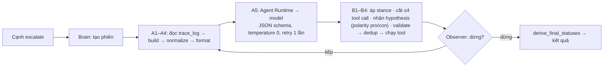

# 02 — Kiến trúc hệ thống

Chi tiết đầy đủ nằm trong `docs/design/*.md`. File này tóm cấu trúc và **ghi rõ phần nào là code thật, phần nào chỉ là thiết kế**.

Ký hiệu trạng thái: ✅ có code + đã chạy thật · 🟡 có code, chưa chạy thật hoặc còn lỗi · 📐 chỉ có thiết kế · ❌ không làm.

## 1. Toàn cảnh



Hai nguyên tắc kiến trúc:
- [DECISION] Chỉ 2 tầng có quyền kết luận. Config Collector là nguồn bằng chứng; bước LLM trong nó là 1 lần gọi có schema, không tool, không vòng lặp → không phải Tầng 2.
- [DECISION] `count > 0` là điều kiện cứng cho `OBSERVED_STRONG`, viết cứng trong code.

## 2. Thành phần và trạng thái

| Thành phần | Code | Trạng thái | Ghi chú |
|---|---|---|---|
| Hạ tầng cụm + harness | `infra/scripts/00–07`, `infra/scenarios/` | ✅ đã chạy (shared-eval, 15 trial ảo, seed 20260101) | Harness mới `e35c9d4` **chưa deploy** |
| Traffic Collector (Prometheus) | `tier1/traffic_collector.py` | ✅ | Query HTTP/gRPC `reporter="waypoint"`, lỗi 5xx, TCP, 7 query theo ngày; `--end-time` (`9818c99`) |
| VictoriaMetrics/VictoriaLogs | `traffic_collector.VictoriaMetricsClient`, `tier1/log_collector.py` | 🟡 code có, chưa chạy thật | Tên field log ztunnel chưa kiểm |
| Config Evidence Collector v2 | `tier1/config_collector/*` | ✅ (LLM + validate) | v2.1 (nhiều nguồn candidate, Parse, index, đọc probe) 📐 phần lớn |
| Tầng 1 lõi | `tier1/{classification,aggregation,candidates,scoring,status,selector_validation,dns_external,storage,pipeline}.py` | ✅ | Trọng số đặt tay `tier1/config.py` |
| Baseline B1/B2 | `tier1/baseline.py` | ✅ | B3 (LLM one-shot) 📐 |
| Bộ máy thí nghiệm | `tier1/{experiment,evaluation,trial_io,ablation}.py`, `infra/scripts/08–12` | ✅ | |
| Tầng 2 | `tier2_agent/tier2_agent/*` | ✅ code v3; v3 chưa chạy 15 trial | |
| Batch Orchestrator | `orchestration/batch.py`, `cli_batch.py`, `wiring.py`, `trial_scope.py` | ✅ đã chạy 15 trial ngày 02/11 | Orchestration v2 (dashboard thay CLI, snapshot, dừng 2 cấp, job runner) 📐 |
| API Server | `orchestration/api/{app,gatekeeper,review,readers,decisions_store}.py` (FastAPI) | 🟡 chạy được (gatekeeper dùng thật 02/11); UI chưa có | |
| Dashboard UI | — | 📐 | `docs/design/DASHBOARD_DESIGN.md` |
| Migration Planner, Policy Impact Validator, Continuity Monitor | — | 📐 | `docs/design/MIGRATION_PLANNER_DESIGN.md`; thuật toán xếp đợt chưa thiết kế |

## 3. Data flow một lần chạy (Batch Orchestrator, code thật)

```
scenario_check → traffic_collector → config_collector → tier1 → tier2 (mỗi cạnh escalate 1 phiên Brain) → SUCCESS/FAILED
```
- [FACT] Lỗi bước nào → cả attempt FAILED, không fallback.
- [FACT] Tách dữ liệu trial trong namespace dùng chung bằng `pair_key` + `owner_map` (`orchestration/trial_scope.py`), không dùng label Prometheus (ambient không hỗ trợ `source.labels[...]`, issue istio#61590).
- [FACT] Tầng 1 trong orchestrator chạy stateless mặc định (tránh trial sau đọc `previous_status` của trial trước).
- Đường đánh giá riêng (không qua orchestrator): `08_export_trial_data.py` → `infra/trial_data/trial-XX.json` → `09_run_experiment.py` (Tầng 1 vs B1/B2, CI 95%, Wilcoxon).

## 4. Tầng 1 — lõi (code thật)

Thứ tự trong `run_tier1`: chuẩn hóa series → phân loại từng series → gộp theo `identity_key` → hợp `C_observed ∪ C_potential` theo `pair_key` → chấm điểm → trạng thái + hysteresis → kiểm selector → scope → lưu.

- Phân loại: DNS → MONITORING (đã xác minh theo SPIFFE ns+SA) → CONTROL_PLANE → (cờ `claimed_monitoring`) → HEALTHCHECK (probe + danh sách ngắn + YAML) → BUSINESS → UNKNOWN.
- `identity_key` 7 phần: (ns nguồn, svc nguồn, SA nguồn, ns đích, svc đích, protocol, port). `pair_key` 4 phần: (ns, svc, ns đích, svc đích); đích chưa phân giải = `raw:<host>`.
- Điểm: `sigmoid(−1,0 + 0,9·recency + 1,1·log_volume + 1,0·distinct_days_ratio − 1,6·healthcheck_ratio − 1,6·monitoring_ratio + 0,8·config_match_strength)`; `volume_reference = 1.674.596` cố định.
- Trạng thái: count=0 → NOT_OBSERVED (config sạch → người duyệt; UNRESOLVED/NOT_FOUND → Tầng 2) · toàn nhiễu → monitoring đã xác minh tự mở / còn lại người duyệt · ≥50% UNKNOWN → UNKNOWN · hysteresis θ_promote 0,68 / θ_demote 0,58.
- Port: `observed` → `observed_log` → `inferred_single_port` → `inferred_protocol_match` → (`config`, chỉ ở PR #2) → `unknown`.

## 5. Tầng 2 — code thật tại `556df77` (v3)

Sơ đồ đầy đủ: `docs/TIER2_MAP.html`.



- Model trả mỗi vòng: `reasoning`, `stance_updates`, `new_hypotheses[{id, statement, polarity}]`, `tool_calls`, `action`.
- 4 tool chỉ đọc: `read_source_code` (grep `src/<service>/`, lọc file sinh từ proto), `read_internal_docs` (README), `read_pr_descriptions` (qua gatekeeper), `read_extended_traffic_window` (window 8–90 ngày, gọi lại `collect_traffic`).
- Trạng thái cuối (v3): CONFLICTED hoặc pro+con cùng SUPPORTED → `CONFLICTING_EVIDENCE`; chỉ con SUPPORTED → `REJECTED_WITH_EVIDENCE`; không gì SUPPORTED → `INSUFFICIENT_BASIS`; pro SUPPORTED + đủ 2 nguồn độc lập (runtime: Tầng 1 count>0 hoặc traffic mở rộng support; tĩnh: code/docs/PR support) → `CONFIDENT`; thiếu → `NEEDS_MONITORING`.
- Evidence `no_match` (không tìm thấy) là trung tính: không nhận stance.
- Tham số: max_iterations 8, timeout phiên 300 s, ≤4 hypothesis mở, ≤4 tool call/vòng, cùng lệnh lỗi 2 lần thì khóa, output tool cắt 4000 ký tự, stale 365 ngày, `tier1_window_days` 7.
- Provider: `TIER2_PROVIDER` (`anthropic` mặc định | `openai`), `TIER2_MODEL`.

## 6. Cơ sở dữ liệu (SQLite, WAL) — tách bảng theo bên ghi

| Bảng | Bên ghi | Trạng thái |
|---|---|---|
| `dependency_evidence` (+ `tier2_status`, `tier2_original_status`, `tier2_session_id`, `attempt_id`) | Batch | ✅ |
| `pipeline_run_log`, `collection_quality_log` | Batch | ✅ |
| `config_raw_items`, `config_extractions`, `config_evidence`, `llm_extraction_cache` | Batch (Collector) | ✅ |
| `agent_sessions`, `agent_rounds`, `trace_log` (+ cột `no_match`), `llm_usage` | Batch (Brain) | ✅ |
| `human_decisions` (append-only, trigger chặn UPDATE/DELETE) | API Server | ✅ |
| `agent_tool_call_log` | API Server (gatekeeper) | ✅ |
| `run_jobs`, `run_control`, `orchestration_settings`, `data_snapshots`, `traffic_series`, `traffic_daily_counts`, `config_rule_sets` | — | 📐 |
| VIEW `latest_successful_attempt`, `dependency_current_state` | — | ✅ (theo thiết kế ORCH v1) |

[FACT] Có test quét mã nguồn khóa luật "API Server không ghi bảng của Batch" (`orchestration/tests/test_write_boundaries.py`).

## 7. API Server (FastAPI, chỉ nghe localhost)

Đã có: đọc trạng thái/cạnh/phiên Tầng 2, hàng đợi review `GET /review-queue`, `GET /reason-codes`, `POST /decisions`, gatekeeper `POST /agent-tool-calls/*`. Job runner, snapshot, settings 📐.

Mã lý do review (12 mã trên nhánh này, `db.REASON_CODES`): `CLEAN_CONFIG_MATCH`, `NEEDS_MANUAL_SELECTOR`, `HIGH_BLAST_RADIUS`, `CONFLICTING_EVIDENCE`, `AGENT_INSUFFICIENT_BASIS`, `TOOL_ADMIN_ATTENTION`, `POLICY_WOULD_BREAK`, `POLICY_UNSUPPORTED_BY_EVIDENCE`, `UNATTRIBUTED_CONFIG_CHANGE`, `EMERGENCY_EXCEPTION_EXPIRED`, `STALE_PERMISSION`, `AGENT_REJECTED` (mới `556df77`). PR #2 thêm `NOISE_ONLY_REVIEW`, `NEEDS_MANUAL_PORT`, `PORT_CONFLICT` — **[TODO]** khi gộp PR #2 và PR #3 phải hợp danh sách này.

## 8. Tech stack và lý do

| Thành phần | Lựa chọn | Lý do |
|---|---|---|
| Ngôn ngữ | Python 3, lõi Tầng 1 chỉ dùng thư viện chuẩn | Dễ test, không phụ thuộc |
| Mesh | Istio **ambient** (đổi từ sidecar 26/09) | Giải bài toán tài nguyên trên VM; ztunnel/waypoint |
| Metrics | Prometheus addon (đã chạy); VictoriaMetrics/Logs (code, chưa chạy) | HA + có port thật từ log |
| Cụm | kind trên VM Azure | Không cần ngân sách cluster thật |
| LLM Collector | OpenAI `gpt-4o-mini`, temperature 0, cache theo hash | Rẻ, structured output |
| LLM Tầng 2 | Thiết kế Anthropic Claude; **chạy thật bằng OpenAI `gpt-4.1-2025-04-14`** | Không có Anthropic key |
| Lưu trữ | SQLite WAL | 1 writer + nhiều reader, đủ quy mô PoC |
| API | FastAPI | — |
| Thống kê | Wilcoxon bắt cặp, CI 95%, scikit-learn cho thử fit trọng số | 15 trial bắt cặp |
