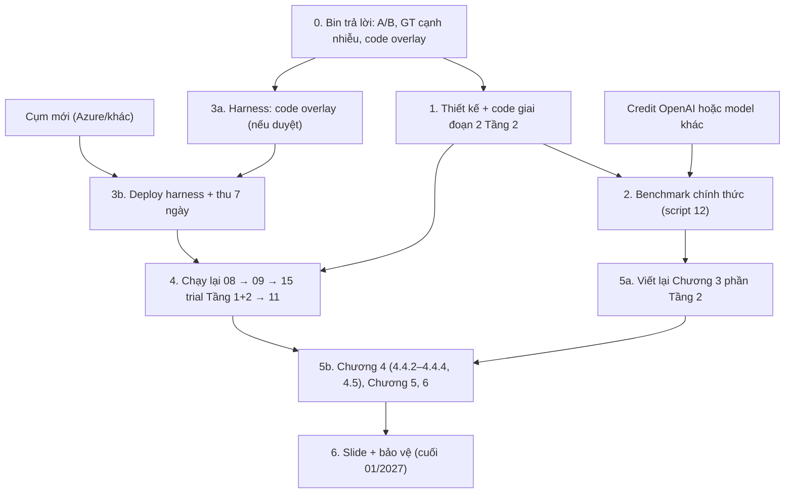

# 08 — Việc tiếp theo

## Trạng thái tại 11/11/2026

- Tầng 1: Bin coi là ổn. Số chạy thật mới nhất: E5 (`05_EXPERIMENT_LOG.md`).
- Tầng 2: code v3 + no_match + REJECTED_WITH_EVIDENCE đã có, **chưa có số liệu chạy thật đầy đủ**. Đang tái thiết kế theo từng giai đoạn: **giai đoạn 1** (Tầng 2 nhận cạnh nào từ Tầng 1, đầu vào gì) đã phân tích; **giai đoạn 2** (thu bằng chứng và suy luận) đang dở.
- Hạ tầng: Azure hết hạn → không có cụm, không có Prometheus sống.
- Báo cáo: Chương 1–3 có; Chương 4 chỉ Tầng 1; Chương 5, 6 trống.

## Việc dang dở nhất

**Chốt thiết kế giai đoạn 2 của Tầng 2.** Hai phương án:

| | (A) Thu bằng chứng cố định → model chấm | (B) Agentic, giả thuyết cố định |
|---|---|---|
| Cách chạy | Code gọi đủ 4 tool theo quy trình cố định; model chỉ đọc kết quả và gán support/contradict | Giữ vòng ReAct; 2 giả thuyết có sẵn ("có phụ thuộc" pro, "không có" con); model không tự đặt giả thuyết |
| Ổn định | Cao | Trung bình |
| Chi phí | ~1–2 lần gọi/cạnh | Nhiều vòng |
| Giữ khung "agent" của Chương 3 | Yếu | Giữ |

Claude nghiêng về (B). **Bin chưa trả lời.**

## Thứ tự ưu tiên và phụ thuộc

## Kế hoạch có tiêu chí hoàn thành

| # | Việc | Phụ thuộc | Xong khi |
|---|---|---|---|
| 0 | Bin quyết: (A)/(B); GT cạnh nhiễu; code overlay thay "nửa cạnh thưa có env" | — | Ghi vào `04_DECISION_LOG.md` |
| 1 | Thiết kế giai đoạn 2 → liệt kê file thay đổi → Bin duyệt → code + test | 0 | Test xanh, `TIER2_MAP.html` + changelog cập nhật, commit trên `tier2-run-tooling` |
| 2 | Benchmark chính thức: chạy lại **v2 và bản mới trên cùng model**, 3 lần/case, đủ 90 phiên | 1, credit | File JSON có đủ 90 phiên; bảng so sánh TP/FP/FN/TN; ghi commit |
| 3 | Dựng cụm, deploy harness `e35c9d4` (+overlay nếu duyệt) với `--sparse-window-start`, thu 7 ngày | Cụm | 7 ngày dữ liệu, traffic cấy không còn lỗi 100% |
| 4 | `08_export` → `09 --validate-selectors` (kèm metric hàng đợi) → 15 trial qua orchestrator → `11` | 1, 3 | `experiment_report`, `tier2_report`, `tier2_edges`, `tier2_wrong` mới, ghi commit + thời gian |
| 5 | Báo cáo: Chương 3 Tầng 2 theo thiết kế mới; Chương 4 với số mới; Chương 5–6; sửa bìa | 2, 4 | Bin duyệt từng chương |
| 6 | Slide, demo dashboard/Planner (tùy thời gian) | 5 | — |

Nếu không có cụm mới kịp: báo cáo dùng E5/E8 (dữ liệu 20–26/10) + benchmark (E9 + bản chính thức ở bước 2), ghi rõ giới hạn.

## Việc phụ (khi còn thời gian, chưa ưu tiên)

- Baseline B3 (LLM one-shot) — đã cam kết trong đề cương v2. **[TODO]** hỏi Bin có giữ không.
- Đánh giá Config Collector (H4) vs regex v1.
- Sửa `noise_precision`.
- Merge PR #2 + PR #3 (chỉ khi Bin nói).
- Migration Planner/dashboard demo.

## Việc an toàn (làm ngay)

- Revoke key OpenAI đã dán vào chat 02/11.
- Thay khóa SSH Azure (từng có trong lịch sử git).
- Xóa GitHub token đã tạo cho VM.
